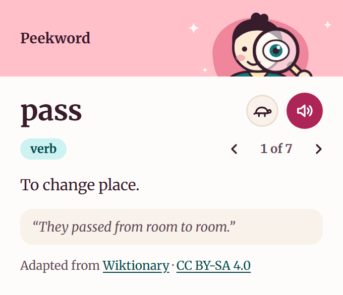

# Peekword

A small Chrome extension that shows the meaning of a word you select, without leaving the page. Built for English learners who read in the browser and want a quick, calm explanation: the word, its part of speech, a meaning, an example, and how to say it.



> Peekword is not on the Chrome Web Store. Install it from this repository using the steps below.

## Features

- **Select, then click.** Highlight a word on any page, open Peekword from the toolbar, and see its entry.
- **Meaning at a glance.** Part of speech, phonetic spelling (when the source has one), a plain definition, and an example sentence.
- **Several meanings.** Step through up to 10 meanings with the arrows or the left and right arrow keys.
- **Listen, or listen slowly.** The speaker button reads the word aloud using your browser's built-in speech synthesis, and the turtle button plays it at half speed. Tap either again to stop.
- **Type a word instead.** If nothing is selected, or the page can't be read (for example `chrome://` pages and the PDF viewer), a search box takes over.
- **Quiet by design.** No account, no tracking, no stored history, and no scripts running on the pages you visit.

## Install

Peekword is a plain Manifest V3 extension with no build step.

1. Download or clone this repository.
2. Open `chrome://extensions` in Chrome.
3. Turn on **Developer mode** (top right).
4. Click **Load unpacked** and choose the repository folder (the one containing `manifest.json`).
5. Optional: pin Peekword from the puzzle-piece menu so it stays in the toolbar.

To update, pull the latest changes and press the reload icon on the Peekword card in `chrome://extensions`.

## Use

1. Highlight a word on a web page.
2. Click the Peekword icon in the toolbar.
3. Read the entry. Use the arrows for other meanings, the speaker for pronunciation, and the turtle for a slow version.

Pages that were open before you installed or reloaded the extension may need a refresh before their selection can be read.

## How it works

When the popup opens, it reads the text selected in the **current tab only** (using the `activeTab` permission and a one-off `scripting.executeScript` call), then looks the word up:

1. **[Free Dictionary API](https://dictionaryapi.dev/)** is tried first, with a 4 second timeout.
2. **[Wiktionary](https://en.wiktionary.org/)** (its REST definition API) is the fallback when the first source is down, slow, or does not have the word.

Entries that come from Wiktionary show a small credit line with links, as its license requires.

Pronunciation uses the Web Speech API (`speechSynthesis`), so it works for any word, including ones with no phonetic text.

## Permissions

| Permission | Why it is needed |
|---|---|
| `activeTab` | Lets the popup read the selected text of the tab you are on, only when you open it. |
| `scripting` | Runs the small function that reads that selection. |
| `https://api.dictionaryapi.dev/*` | Fetches the definition from the Free Dictionary API. |
| `https://en.wiktionary.org/*` | Fetches the definition from Wiktionary when needed. |

There is no content script, no background worker, and no storage permission.

## Privacy

Peekword has no server and collects nothing. The word you look up is sent to the dictionary services above, and nothing is saved. See [PRIVACY.md](PRIVACY.md) for details.

## Known limitations

- **English only, one word at a time.** Phrases and sentences are mostly not found.
- **Free services, no guarantees.** The Free Dictionary API has had outages. When it is down, a lookup waits about 4 seconds before Wiktionary answers.
- **Examples are not always available.** In a sample of 66 words, the first Wiktionary meaning had an example sentence for about 7 in 10 words.
- **Only part of speech, no grammar notes.** Neither source explains grammar.
- **Restricted pages.** Chrome does not let extensions read `chrome://` pages, the Chrome Web Store, or its built-in PDF viewer. Use the search box there.
- **Voice quality depends on your system.** Pronunciation uses the voices installed on your computer.

## Project structure

```
manifest.json     Extension manifest (Manifest V3)
popup.html        Popup markup
popup.css         Popup styles
popup.js          Reads the selection, looks the word up, renders the entry, speaks it
assets/           Toolbar and extension icons
assets/fonts/     Merriweather (variable, latin) and its license
docs/             README screenshot
PRIVACY.md        Privacy policy
```

## Development

There is no build step and no dependencies. Edit the files, then press the reload icon for Peekword in `chrome://extensions` and reopen the popup.

To check the script for syntax errors without a browser:

```
node --check popup.js
```

The popup is a fixed 340px-wide window that fills Chrome's rectangular popup frame edge to edge, because extensions cannot round or make that frame transparent.

## Ideas for later

- A right-click "look up" menu item.
- Recorded human audio where a source provides it, with speech synthesis as fallback.
- Grammar notes, which would need an AI source.
- Saving words for later review.

## Credits and licenses

- **Peekword** is released under the [MIT License](LICENSE).
- **Definitions** shown from Wiktionary are available under [CC BY-SA 4.0](https://creativecommons.org/licenses/by-sa/4.0/). Peekword does not bundle any dictionary data; it fetches entries at lookup time and shows the credit with them.
- **Free Dictionary API** by [meetDeveloper](https://github.com/meetdeveloper/freedictionaryapi), at [dictionaryapi.dev](https://dictionaryapi.dev/).
- **Merriweather** typeface by The Merriweather Project Authors, licensed under the [SIL Open Font License 1.1](assets/fonts/OFL.txt).
- The mascot and icons are original artwork for this project.
